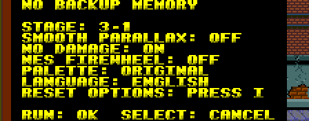

# How to change the options

Ninja Ryukenden Enhanced has an in-game menu for **Level Select**,
**smooth parallax**, **No Damage**, **NES Firewheel**, the **palette** and
the **language**. The language can also be changed on the title screen with
the original game's own switch.

When the console is switched on or reset, the game starts with these
defaults:

| Setting | Default | Where to change it |
| --- | --- | --- |
| Language | English | In-game menu or title screen |
| Stage | 1-1 | In-game menu |
| Smooth parallax | ON (Enhanced) | In-game menu |
| No Damage | OFF | In-game menu |
| NES Firewheel | OFF | In-game menu |
| Palette | Original | In-game menu |

Since 1.11-dev the settings are kept when the console has backup RAM: see
[Saving your settings](#saving-your-settings). Without it the game starts
with these defaults every time, as before.

## Language

1. On the title screen (**PUSH RUN**), hold **I** and **II**.
2. While holding them, press **Select**. Each press switches to the next
   language: **English → Chinese → Japanese →** English. The line under the
   logo shows the current language.
3. Press **Run** to start the game.


The language is used for the story scenes and the game's text. Some title
and chapter artwork keeps its original Japanese lettering. The in-game
menu's **LANGUAGE** row changes the same setting.

## The in-game menu

1. During play, press **Select**. The game pauses and a window opens over
   the playfield; the status bar stays as it is. While the window is open,
   the line under the status bar shows the patch version and the project's
   home (github.com/tigermonkeyfish), and the game's sprites (Ryu, enemies,
   the held item's icon) are hidden:

   ```
   BACKUP MEMORY FOUND

   STAGE: 1-1
   SMOOTH PARALLAX: ON
   NO DAMAGE: OFF
   NES FIREWHEEL: OFF
   PALETTE: ORIGINAL
   LANGUAGE: ENGLISH
   RESET OPTIONS: PRESS I
   RUN: OK  SELECT: CANCEL
   ```

   The top line is not a setting: it says what the game found in the
   console's backup memory (see [Saving your settings](#saving-your-settings)).

2. Press **Up** or **Down** to choose a setting. The chosen setting's value
   blinks.
3. Press **Left** or **Right** to change it.
4. Press **Run** (**OK**) to apply your choices, or **Select** (**CANCEL**)
   to close the window and keep playing with nothing changed. **I** and
   **II** do nothing in the menu except on the **RESET OPTIONS** row
   (below).

The music and sound effects pause while the window is open, as in the
game's own pause, and go on from the same note when it closes.


**Run** always restarts the stage shown in the menu from its beginning, even
when you changed only another setting. Ryu's health is refilled and the
stage timer starts again from full; your score and lives carry over.

### Level Select (stage jump)

With **STAGE** chosen, press **Left** or **Right** to step through the
stages: 1-1, 1-2, 2-1 and so on up to 6-4 A, 6-4 B and 6-4 C (the final
fights). The list wraps around, so **Left** from 1-1 goes straight to
6-4 C. Press **Run** to start the chosen stage.


### Smooth parallax

With **SMOOTH PARALLAX** chosen, press **Left** or **Right** to choose:

- **ON**: this patch's smoother, slower parallax backgrounds (Enhanced, the
  default).
- **OFF**: the game's original backgrounds.


Enhanced parallax covers 1-1, 2-2, 3-1, 3-2, 4-1, 4-2, 5-2, 5-3, 5-4, 6-1
and 6-3. The other stages look the same with either setting. Enhanced
changes only the backgrounds: in emulator tests, Enhanced plays frame for
frame like the original game in all of these stages.

### No Damage

With **NO DAMAGE** chosen, press **Left** or **Right** to choose **OFF** (the
default) or **ON**. With No Damage on, enemies and their attacks don't hurt
Ryu or knock him back. Falling into a pit or running out of time still costs
a life.



### NES Firewheel

**ON** makes the Fire Wheel art work like the NES game's Invincible Fire
Wheel: nothing hurts Ryu while it spins, its reach is the NES one, bosses lose
health steadily while it touches them, and it lasts a set time. **OFF** (the
default) keeps the PC Engine game's Fire Wheel.

### Palette

**Left** and **Right** step through the values in this order, wrapping
around: ORIGINAL, APOCALYPSE, NES-A, NES-B, SMS, GB DMG.

- **ORIGINAL** (the default): the game's own colours.
- **APOCALYPSE**: the scenery turns to lava, fire and ash: skies and blues glow
  red and orange, greens scorch to brown, stone, walls and pavements take
  the dark golds of the 2-2 bridge columns, whites become embers and ash.
  The darkest greens and greys stay dark brown instead of turning black, so
  the night stages (4-1's trees, 5-1, 6-2) keep their detail. Ryu, the
  enemies and the status bar keep their own colours, so they stand out.
- **NES-A**: the game in the NES's own colours only, with all the PC
  Engine detail, read like NES Ninja Gaiden: every stage, Ryu, the HUD,
  enemies, items, each boss in its NES fight colours, and the colours the
  game animates (water, lamps and the like). A draft, still under review.
- **NES-B**: the same NES colours and the same choices, re-lit: the dark
  shades of each part of the scenery are lifted towards the lighter NES
  shades the NES stages use, so the picture reads lighter and closer to the
  NES game. Ryu, the enemies, items, bosses and the status bar are as in
  NES-A. Also a draft.
- **SMS**: everything on screen (scenery, status bar, Ryu, enemies, bosses)
  in the Sega Master System's 64 colours, with all of the PC Engine
  picture's detail: each colour is moved to the nearest Master System
  shade, channel by channel. The darkest greens and greys take the darkest
  Master System green, olive or grey instead of black, so the night stages
  keep their detail.
- **GB DMG**: the four green shades of the original Game Boy.

ORIGINAL, GB DMG, APOCALYPSE and SMS change at once while the window is open, so
you can look at the choice before you accept it; **Select** (cancel) puts
the old colours back. NES colours are other palette data that the stage
loads, so they appear when **Run** restarts the stage: while NES-A or NES-B
is highlighted the colours on screen stay as they are. (With the window
opened in an NES mode, the other values preview from the NES colours; Run
reloads the stage in the real colours of the mode chosen.) Story scenes,
the title and the ending always keep the original colours.

### Language

**ENGLISH**, **JAPANESE** or **CHINESE**: the same setting as the title
screen's switch. The new language is used from the next story scene or title
screen on.

Press **Run** to apply.

### Reset options

Since 1.11-dev. Choose **RESET OPTIONS** (the row under LANGUAGE; **Up**
from STAGE also goes there) and press **I** (or **II**): every setting in
the window goes back to its default (SMOOTH PARALLAX ON, NO DAMAGE OFF, NES
FIREWHEEL OFF, PALETTE ORIGINAL, LANGUAGE ENGLISH; the table at the top of
this page), and the colours on screen change back to the original ones at
once, as when you choose ORIGINAL yourself. **STAGE** is left as it is.

Nothing is applied yet: press **Run** to apply the defaults (the stage shown
in the STAGE row restarts, the same stage you were playing unless you
changed it, and the settings are saved as with any Run), or **Select** to
cancel and keep everything as it was. You can still change any setting
after the reset before you press Run. **Left** and **Right** do nothing on
this row.

## Saving your settings

Since 1.11-dev. Tested in emulators only so far, including a test
emulator that models the backup RAM's lock and the System Card's own
routines reading the game's file; the first test on a console is still to
come, so treat this section as what is expected, not as what was seen on
hardware.

Pressing **Run** in the in-game menu saves every setting of the menu except
the stage: smooth parallax, No Damage, NES Firewheel, the palette and the
language. They go to the console's backup RAM, the memory CD games keep
their saves in, as one small file named `NR ENHANCE` (26 bytes) beside the
other games' saves. At the next power-on or reset the game starts with
them.

- **Select** (cancel) saves nothing.
- A language chosen on the title screen is saved by the next **Run** in the
  menu.
- The game never deletes, moves or changes another game's save. If the
  memory is full or looks damaged it writes nothing and tells you so.
- To forget the saved settings, delete the file `NR ENHANCE` in a backup
  manager (the System Card's, or your cartridge's or emulator's).

### The status line

The window's top line shows what the game found at power-on, and after a
**Run** what the save came to. Open the menu again in the restarted stage
to see the result of that Run. (Before the reset-row build it was the last
line and read `SAVE: OK`, `SAVE: READY` and so on.) The game cannot tell
which device holds the memory (a Duo or CD-ROM unit, a Ten no Koe 2, a
flash cartridge), so the line says "backup memory" for all of them.

| Text | Meaning | What to do |
| --- | --- | --- |
| `SETTINGS SAVED` | Before Run: the saved settings were found and loaded. After Run: the settings were saved and read back. | Nothing. |
| `BACKUP MEMORY FOUND` | Backup RAM is there and formatted; no settings saved yet. | Press Run to save. |
| `NO BACKUP MEMORY` | No backup RAM was found, or it is blank. Nothing was written (a blank, writable memory is formatted by the first Run and then shows SETTINGS SAVED). | See the platform notes below. Without backup RAM the game works as before, with the defaults at every start. |
| `BACKUP MEMORY FULL` | The backup RAM has no room for the 26 bytes. Nothing was written. | Delete a save you no longer need in a backup manager. |
| `BACKUP MEMORY ERROR 1` | After Run: the memory is not formatted but not blank either. Nothing was written. | Format it in the System Card's backup manager (this erases what is there). |
| `BACKUP MEMORY ERROR 2` | The list of saves is damaged (sizes or pointers that do not add up). Nothing was written. | Check the other saves in a backup manager; formatting clears it. |
| `BACKUP MEMORY ERROR 3` | A file named `NR ENHANCE` of another size is there. Nothing was written. | Delete that file. |
| `BACKUP MEMORY ERROR 4` | The settings were written but did not read back. | The memory does not hold what is written to it (write-protected or failing). |
| `BACKUP MEMORY ERROR 5` | At power-on: the file is there but its contents do not check out; the defaults are used. | Press Run: the file is written again. |

### What each platform needs

| Platform | What to do | Status |
| --- | --- | --- |
| PC Engine Duo, Duo-R, Duo-RX, TurboDuo (built-in backup RAM), any flash cartridge | Nothing, if the backup RAM was ever formatted (a CD game or the System Card does that). On the Turbo EverDrive Pro the cartridge's own CD functions are off in these consoles, so the game uses the console's memory. | Expected; not yet tested on hardware |
| A console with a CD-ROM unit, a Ten no Koe 2 or a Backup Booster | The same. | Expected (the same registers; the game sends the three-byte unlock those units' software uses) |
| Turbo EverDrive Pro on a console without CD | In the cartridge's Options set **Default EXP Device** to `TNK2` or `CDROM` (its manual). With `OFF` the menu shows `NO BACKUP MEMORY`. | From the manual; not yet tested |
| MiSTer (TurboGrafx16 core) | Backup RAM is always there. The core writes its save file only when you choose **Save Backup RAM** in the OSD, or with **Autosave** on when the OSD is opened after a save: do one of the two before switching off. | Read from the core's source; not tested |
| Geargrafx (desktop) | Nothing: "Force Backup RAM" is on by default. | The headless build was tested with backup RAM images |
| Other emulators | Works where the emulator gives a HuCard backup RAM. | Not tested |
| A console with nothing attached | `NO BACKUP MEMORY`; the game plays as before. | Emulated |

The first save to a blank memory formats it first, which takes about half
a frame longer, once. With an unusually long list of saves (more than 56
files, or more than 45 beside the game's own; real saves do not come near
that in this memory) the game's boot runs one frame later; nothing else
changes.

The details and the evidence are in
[the validation record](validation/bram-save.md); the maintainer's console
test list is the
[hardware checklist](validation/bram-save-hardware-checklist.md).

---

These screenshots were made in an emulator with
`scripts/guide_screenshots.py`; they show the original game's screens for
instruction. See the [README](../README.md) for patching and downloads.
