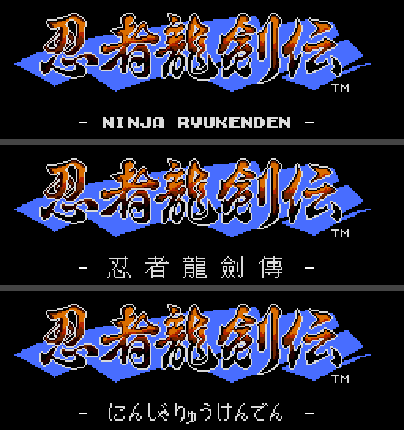
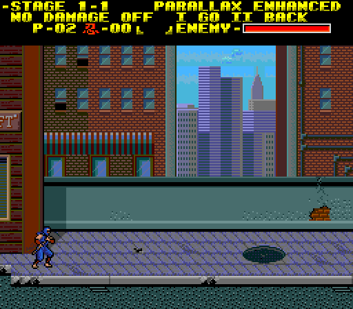

# How to change the options

Ninja Ryukenden Enhanced has an in-game menu for **Level Select**,
**parallax** and **No Damage**. The language is changed on the title screen
with the original game's own switch.

When the console is switched on or reset, the game starts with these
defaults:

| Setting | Default | Where to change it |
| --- | --- | --- |
| Language | English | Title screen |
| Stage | 1-1 | In-game menu |
| Parallax | ENHANCED | In-game menu |
| No Damage | OFF | In-game menu |

Settings are not saved. They return to these defaults after a reset or
power-off.

## Language

1. On the title screen (**PUSH RUN**), hold **I** and **II**.
2. While holding them, press **Select**. Each press switches to the next
   language: **English → Chinese → Japanese →** English. The line under the
   logo shows the current language.
3. Press **Run** to start the game.

The language is used for the story scenes and the game's text. Some title
and chapter artwork keeps its original Japanese lettering.

## The in-game menu

1. During play, press **Select**. The game pauses, and the menu replaces the
   score bar at the top of the screen.
2. Press **Up** or **Down** to choose a setting. A dash (**-**) marks the
   chosen one: **STAGE**, **PARALLAX** or **NO DAMAGE**.
3. Press **Left** or **Right** to change it.
4. Press **I** (**GO**) to apply your choices, or **II** (**BACK**) to close
   the menu and keep playing with nothing changed.

**I** always restarts the stage shown in the menu from its beginning, even
when you changed only parallax or No Damage. Ryu's health is refilled and
the stage timer starts again from full; your score and lives carry over.

### Level Select (stage jump)

With the dash on **STAGE**, press **Left** or **Right** to step through the
stages: 1-1, 1-2, 2-1 and so on up to 6-4 A, 6-4 B and 6-4 C (the final
fights). The list wraps around, so **Left** from 1-1 goes straight to
6-4 C. Press **I** to start the chosen stage.

### Parallax

With the dash on **PARALLAX**, press **Left** or **Right** to choose:

- **ENHANCED**: this patch's smoother, slower parallax backgrounds (the
  default).
- **ORIGINAL**: the game's original backgrounds.

Enhanced parallax covers 1-1, 2-2, 3-1, 3-2, 4-1, 4-2, 5-2, 5-3, 5-4, 6-1
and 6-3. The other stages look the same with either setting. Enhanced
changes only the backgrounds: in emulator tests, Enhanced plays frame for
frame like the original game in all of these stages.

### No Damage

With the dash on **NO DAMAGE**, press **Left** or **Right** to choose
**OFF** (the default) or **ON**. With No Damage on, enemies and their attacks
don't hurt Ryu or knock him back. Falling into a pit or running out of time
still costs a life.

Press **I** to apply.

---

These screenshots were made in an emulator with
`scripts/guide_screenshots.py`; they show the original game's screens for
instruction. See the [README](../README.md) for patching and downloads.
