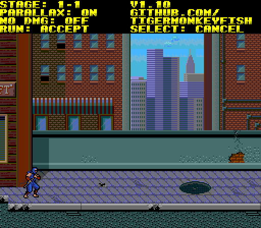
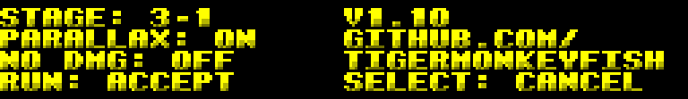

# How to change the options

Ninja Ryukenden Enhanced has an in-game menu for **Level Select**,
**smooth parallax**, **No Damage**, **NES Firewheel**, the **palette** and
the **language**. The language can also be changed on the title screen with
the original game's own switch.

When the console is switched on or reset, the game starts with these
defaults:

| Setting | Default | Where to change it |
| --- | --- | --- |
| Language | English | In-game menu or title screen |
| Stage | 1-1 | In-game menu |
| Smooth parallax | ON (Enhanced) | In-game menu |
| No Damage | OFF | In-game menu |
| NES Firewheel | OFF | In-game menu |
| Palette | Original | In-game menu |

Settings are not saved. They return to these defaults after a reset or
power-off.

## Language

1. On the title screen (**PUSH RUN**), hold **I** and **II**.
2. While holding them, press **Select**. Each press switches to the next
   language: **English → Chinese → Japanese →** English. The line under the
   logo shows the current language.
3. Press **Run** to start the game.


The language is used for the story scenes and the game's text. Some title
and chapter artwork keeps its original Japanese lettering. The in-game
menu's **LANGUAGE** row changes the same setting.

## The in-game menu

1. During play, press **Select**. The game pauses and a window opens over
   the playfield; the status bar stays as it is. While the window is open,
   the line under the status bar shows the patch version and the project's
   home (github.com/tigermonkeyfish), and the game's sprites (Ryu, enemies,
   the held item's icon) are hidden:

   ```
   STAGE: 1-1
   SMOOTH PARALLAX: ON
   NO DAMAGE: OFF
   NES FIREWHEEL: OFF
   PALETTE: ORIGINAL
   LANGUAGE: ENGLISH

   RUN: OK  SELECT: CANCEL
   ```

2. Press **Up** or **Down** to choose a setting. The chosen setting's value
   blinks.
3. Press **Left** or **Right** to change it.
4. Press **Run** (**OK**) to apply your choices, or **Select** (**CANCEL**)
   to close the window and keep playing with nothing changed. **I** and
   **II** do nothing in the menu.

The music and sound effects pause while the window is open, as in the
game's own pause, and go on from the same note when it closes.



**Run** always restarts the stage shown in the menu from its beginning, even
when you changed only another setting. Ryu's health is refilled and the
stage timer starts again from full; your score and lives carry over.

### Level Select (stage jump)

With **STAGE** chosen, press **Left** or **Right** to step through the
stages: 1-1, 1-2, 2-1 and so on up to 6-4 A, 6-4 B and 6-4 C (the final
fights). The list wraps around, so **Left** from 1-1 goes straight to
6-4 C. Press **Run** to start the chosen stage.



### Smooth parallax

With **SMOOTH PARALLAX** chosen, press **Left** or **Right** to choose:

- **ON**: this patch's smoother, slower parallax backgrounds (Enhanced, the
  default).
- **OFF**: the game's original backgrounds.


Enhanced parallax covers 1-1, 2-2, 3-1, 3-2, 4-1, 4-2, 5-2, 5-3, 5-4, 6-1
and 6-3. The other stages look the same with either setting. Enhanced
changes only the backgrounds: in emulator tests, Enhanced plays frame for
frame like the original game in all of these stages.

### No Damage

With **NO DAMAGE** chosen, press **Left** or **Right** to choose **OFF** (the
default) or **ON**. With No Damage on, enemies and their attacks don't hurt
Ryu or knock him back. Falling into a pit or running out of time still costs
a life.


### NES Firewheel

**ON** makes the Fire Wheel art work like the NES game's Invincible Fire
Wheel: nothing hurts Ryu while it spins, its reach is the NES one, bosses lose
health steadily while it touches them, and it lasts a set time. **OFF** (the
default) keeps the PC Engine game's Fire Wheel.

### Palette

- **ORIGINAL** (the default): the game's own colours.
- **NES-A**: the game in the NES's own colours only, with all the PC
  Engine detail, read like NES Ninja Gaiden: every stage, Ryu, the HUD,
  enemies, items, each boss in its NES fight colours, and the colours the
  game animates (water, lamps and the like). A draft, still under review.
- **NES-B**: the same NES colours and the same choices, re-lit: the dark
  shades of each part of the scenery are lifted towards the lighter NES
  shades the NES stages use, so the picture reads lighter and closer to the
  NES game. Ryu, the enemies, items, bosses and the status bar are as in
  NES-A. Also a draft.
- **GB DMG**: the four green shades of the original Game Boy.
- **HELL**: the scenery turns to lava, fire and ash: skies and blues glow
  red and orange, greens scorch to brown, stone, walls and pavements take
  the dark golds of the 2-2 bridge columns, whites become embers and ash.
  Ryu, the enemies and the status bar keep their own colours, so they stand
  out.
- **SMS**: everything on screen (scenery, status bar, Ryu, enemies, bosses)
  in the Sega Master System's 64 colours, with all of the PC Engine
  picture's detail: each colour is moved to the nearest Master System
  shade, channel by channel.

ORIGINAL, GB DMG, HELL and SMS change at once while the window is open, so
you can look at the choice before you accept it; **Select** (cancel) puts
the old colours back. NES colours are other palette data that the stage
loads, so they appear when **Run** restarts the stage: while NES-A or NES-B
is highlighted the colours on screen stay as they are. (With the window
opened in an NES mode, the other values preview from the NES colours; Run
reloads the stage in the real colours of the mode chosen.) Story scenes,
the title and the ending always keep the original colours.

### Language

**ENGLISH**, **JAPANESE** or **CHINESE**: the same setting as the title
screen's switch. The new language is used from the next story scene or title
screen on.

Press **Run** to apply.

---

These screenshots were made in an emulator with
`scripts/guide_screenshots.py`; they show the original game's screens for
instruction. See the [README](../README.md) for patching and downloads.
